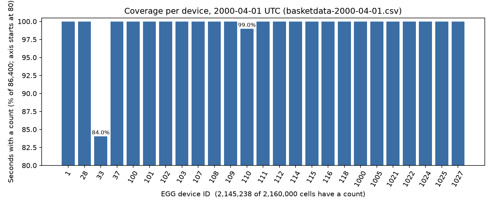
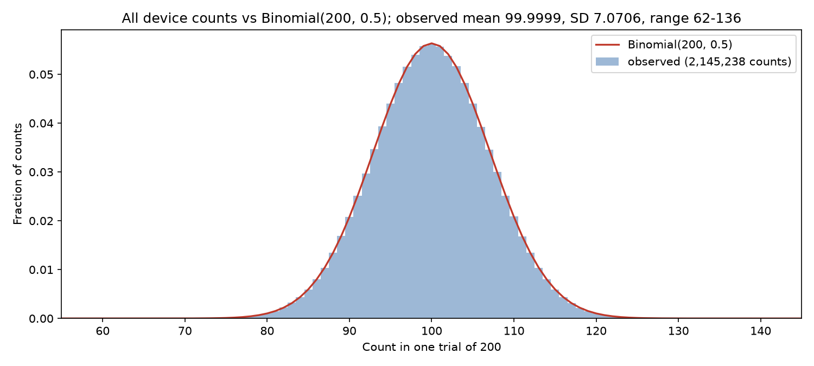
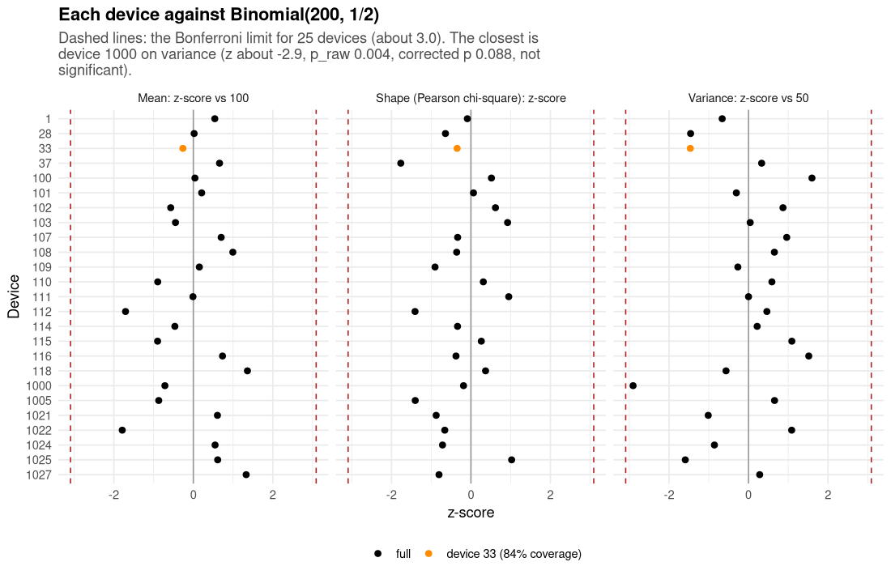
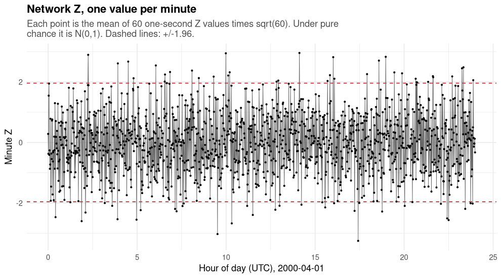
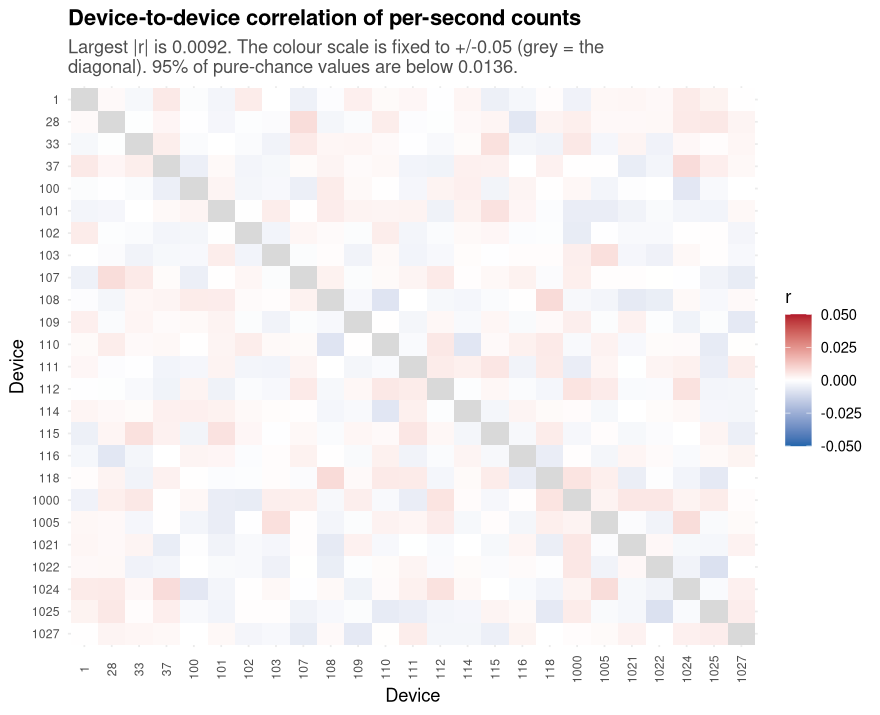
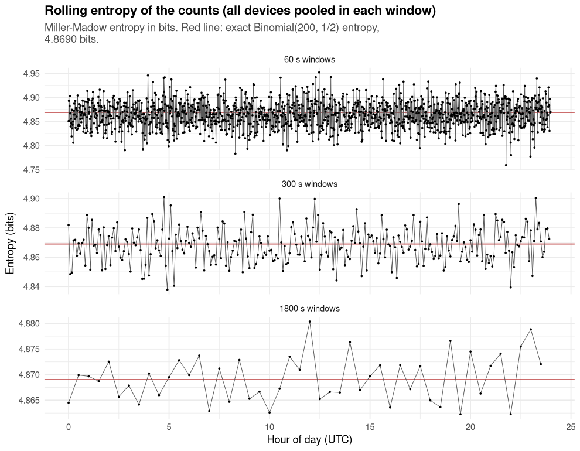
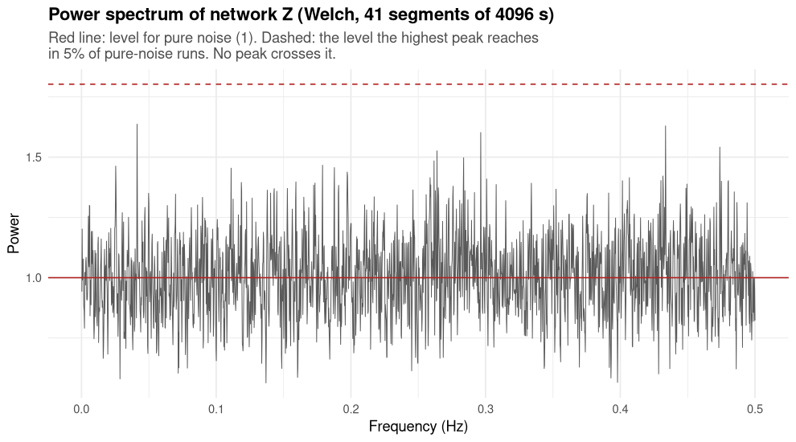
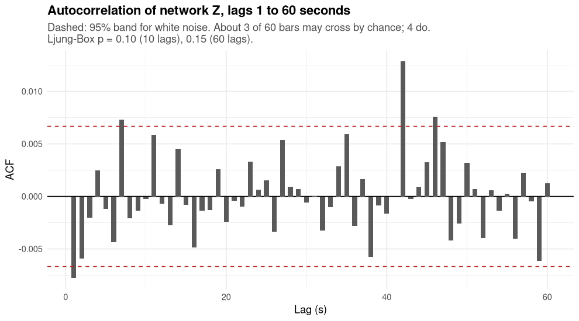
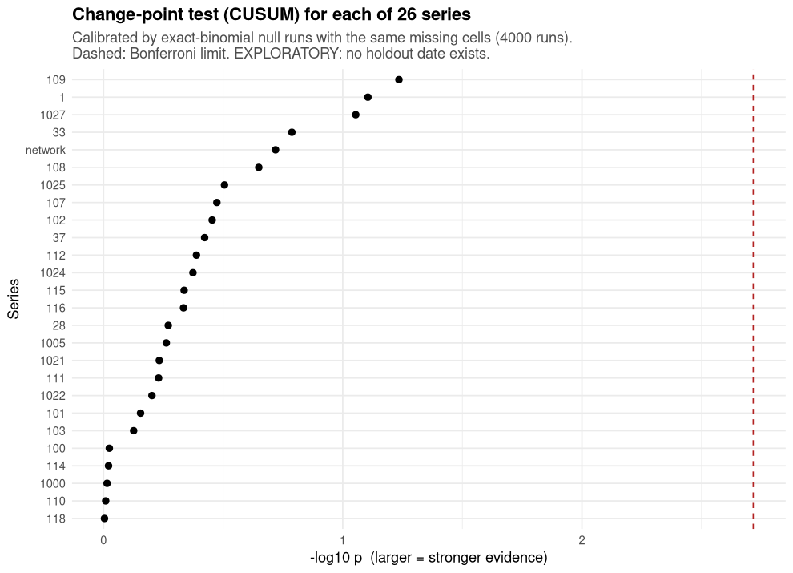

# egg-alp

One day of random-number counts from 25 EGG devices, a written research plan for studying them, and the ALP logic language used to write the plan's rules. All three are here, and the plan has been carried out on the real data.

**What we found:** on 1 April 2000 the 25 devices behaved like fair coins. Of 20 headline tests, 18 found nothing, and one is only a number with no test attached. One weak lead survived correction, a faint pattern in device 1025, and it needs another day of data before it means anything.

| | |
|---|---|
| The plan | [`spec/EGG-001.dspy.txt`](spec/EGG-001.dspy.txt) |
| The data | [`data/basketdata-2000-04-01.csv`](data/basketdata-2000-04-01.csv), 86,400 rows, 25 devices |
| The language | [`alp/`](alp/), the ALP Horn-clause engine in C++ |
| The results | [`docs/EGG-001-REPORT.md`](docs/EGG-001-REPORT.md) and [`egg/results/`](egg/results/) |
| The whole build | `make egg001` (about 30 seconds) |

## The data

Every second, each device reports how many of 200 coin-flip-style trials came up 1. For a fair coin that number centres on 100 and wobbles by about 7.

- 86,400 seconds, 25 devices, 2,160,000 cells in total.
- 2,145,238 cells hold a count. 14,762 are empty, meaning nothing was recorded.
- Counts average 99.9999 and run from 62 to 136.



*Device 33 reported only 84.0% of the day, and its gaps make up 94% of all the empty cells. Empty cells are never turned into zeros.*



*All 2,145,238 counts as bars, with the fair-coin curve in red. They line up.*

## What the experiment found

### Each device, and all of them together, look like fair coins

Pooled over every count, the fair-coin test gives p = 0.39, which means no sign of any difference. The mean is 99.9999 against 100 expected, and the spread is 49.99 against 50.



*Each device compared with the fair-coin reference. The biggest outlier, the spread of device 1000, drops to p = 0.088 after correcting for checking 25 devices, so it isn't significant.*

### The network as a whole is flat

Each second, all reporting devices are combined into one score, Z. For fair coins its variance is 1, and here it is 1.0033. There were 245 seconds with an extreme score against 227 expected, which is ordinary. The single most extreme second looks rare on its own, but with 86,400 seconds to search it has a corrected p of 0.16.



### The devices don't move together

The strongest link between any two devices is a correlation of 0.0092 (p = 0.90). Links at delays of up to a minute, and the number of devices in the tail each second, show nothing either.



### Entropy and spread over time look normal

We watched each device in windows of 1 minute, 5 minutes and 30 minutes. The best of 225 rolling tests ends at a corrected p of 0.058.



### No repeating pattern

The network score has no peak above chance in its spectrum (p = 0.64 and p = 0.49 for the two methods).



### One lead: device 1025

Device 1025 is the one result that survived correction. A second's count has a very faint link to the next few seconds (corrected p = 0.010), and the size of the link is tiny at 0.0013. It's from one day of data, so we treat it as a question for the next day, not an answer.



### No change points

We looked for a moment when any device, or the network, changed its average level. None of the 26 series has one. The detection setting was tuned on simulated fair-coin data with the same gaps, and on 40 fresh fair-coin runs it also found nothing.



## Results table

All 20 headline tests, as written to [`egg/results/headline.tsv`](egg/results/headline.tsv).

| Test | Raw p | Corrected p | Verdict |
|---|---|---|---|
| Pooled counts vs fair coin (Pearson) | 0.392 | 0.392 | nothing |
| Pooled counts vs fair coin (likelihood ratio) | 0.396 | 0.396 | nothing |
| Per-device fit, best (device 1025) | 0.153 | 1 | nothing |
| Per-device fit, likelihood ratio, best (device 111) | 0.111 | 1 | nothing |
| Per-device mean, best (device 1022) | 0.074 | 1 | nothing |
| Per-device spread, best (device 1000) | 0.0035 | 0.088 | nothing |
| Network Z variance | n/a | n/a | 1.0033, interval 0.993 to 1.014 |
| Network seconds with extreme score | 0.232 | 0.232 | nothing |
| Most extreme network second | 0.0000019 | 0.161 | nothing |
| Rolling windows, best of 225 | 0.00026 | 0.058 | nothing |
| Largest device-to-device correlation | 0.903 | 0.903 | nothing |
| Delayed device-to-device correlation | 0.858 | 0.858 | nothing |
| Devices in the tail each second | 0.140 | 0.140 | nothing |
| Network serial correlation | 0.098 | 0.537 | nothing |
| **Device 1025 serial correlation** | **0.0002** | **0.010** | **lead, needs more data** |
| Network spectrum, overall | 1 | 1 | nothing |
| Network spectrum, highest peak | 0.645 | 0.645 | nothing |
| Welch spectrum, highest peak | 0.494 | 0.494 | nothing |
| Change point, level shift (device 109) | 0.058 | 0.765 | nothing |
| Change point, best split (device 1022) | 0.019 | 0.273 | nothing |

## The full build

`make egg001` runs every part below and prints PASS, FAIL or UNAVAILABLE for each. Last run: **13 PASS, 3 UNAVAILABLE, 0 FAIL**.

| Part | Language | What it does | Result |
|---|---|---|---|
| Input check | shell | Confirms the CSV is the original file | PASS |
| Data inspection | AWK | Reads the file once, counts rows, gaps and ranges | PASS |
| Number crunching | Futhark | Fast per-device statistics | PASS |
| Missing-cell test | Futhark | Results don't change when a missing cell's stored value changes | PASS |
| Spectra | Octave | Frequency analysis | PASS |
| Statistics | R | Fit tests, network Z, correlations, change points | PASS |
| Cross-check | all of the above | 34 comparisons between AWK, Futhark, R and Octave | PASS, 0 differ |
| Proofs | Dafny | 50 facts about counting with gaps, all verified | PASS |
| Proofs | Lean 4 | The same ideas, checked a second way, no gaps in the proofs | PASS |
| Runner | Elixir/OTP | Runs the stages in a fixed order and records hashes of every output | PASS, 13 tests |
| Contracts | ALP | Rules for the data and the claims, checked against the real results | PASS |
| Database | T-SQL | Table layout, checked for syntax | PASS |
| Cross-check | SAS | Written, not run (not installed here) | UNAVAILABLE |
| Segmentation | AMPL | Written, not run (not installed here) | UNAVAILABLE |
| Native MATLAB | MATLAB | Written, not run (not installed here) | UNAVAILABLE |

### The ALP contracts

ALP is the language the rules are written in: plain "A is true if B and C are true" statements. The contracts say what counts as valid data (counts from 0 to 200, a missing cell is never a zero, the day starts and ends on the right second), how each claim is classified (verified, hypothesis or unverified), and what the work must never claim. 1,225 facts from the real results are checked against 77 rules, with no violations. When we feed in deliberately wrong facts, 63 of the rules fire, so the check does catch things.

```sh
cd egg/alp_check/horn && make check
```

### The proofs

Dafny and Lean prove that missing cells are never counted as zero, that counts and sums stay in range, that the network score is only worked out when at least one device reports, and that reordering the devices changes nothing.

### The reproducibility manifest

[`egg/results/manifest.json`](egg/results/manifest.json) records the software versions, the seeds, the input file's fingerprint and a fingerprint of every output, so the whole run can be compared byte for byte.

## Run it yourself

```sh
make egg001            # about 30 seconds, everything installed on your machine
make egg001-manifest   # writes the manifest
make egg001-full       # also re-runs the slow R steps, about 25 minutes
```

Check the data file:

```sh
cd data && sha256sum -c SHA256SUMS && cd ..
python3 data/verify_data.py
```

Build and test the ALP engine:

```sh
cmake -S alp -B build -DALP_GRAPHBLAS_ENABLE=OFF
cmake --build build
ctest --test-dir build --output-on-failure
```

## What's in the repo

```
spec/            the EGG-001 research plan
data/            the CSV, its checksum, and a script that re-checks its numbers
alp/             the ALP logic engine (source, tests, .alp libraries)
egg/awk          data inspection
egg/futhark      fast statistics
egg/octave       spectra
egg/r            statistics and change points
egg/dafny        proofs
egg/lean         proofs, second tool
egg/elixir       the runner
egg/contracts    ALP rules for the data and the claims
egg/alp_check    runs those rules against the real results
egg/tsql, ampl, sas    written, partly run (see the table above)
egg/results      every table the analysis wrote
docs/            the report, the build notes and all figures
```

## What this is and isn't

The research code uses no AI, no agents and no language models. Random numbers come only from fixed seeds, so every run gives the same answer. The data is a fixed file from one day. Nothing here says anything about intention, events, consciousness or simulations, because no event data exists and none was made up.

## License

Dual-licensed: AGPL-3.0, and the SnapKitty Opaque Source License v1.0 (the `LICENSE` file). Copyright Ahmad Ali Parr.
